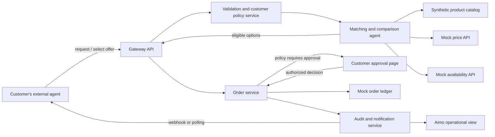

# Architecture and responsibilities

## Logical flow

This is a conceptual design, not a deployed system. The policy service and order service are authoritative deterministic components even if agents help interpret and explain. A request may require a policy check before matching and a further check on the exact selected order before commitment.

## Components

**External customer agent.** Translates a buyer's need into a structured request, submits it, reviews returned choices, selects one, and receives status updates. It cannot modify customer policy or approve its own order merely by sending a message.

**Gateway and validation.** Authenticate the caller, associate it with a customer account and delegated scopes, validate typed JSON, normalize units where supported, and return structured errors. Natural language is convenience input; structured data is the authority for checks.

**Customer-interest component.** Uses the customer's configured rules to surface constraints and explain results. It may be implemented as an agent, but it must not decide or override hard policy. Saved policy and authorized customer identities come from trusted configuration, not from instructions embedded in the external request.

**Matching agent.** Uses narrowly scoped catalog, pricing and availability tools. It identifies candidates, filters against hard requirements, compares eligible results and produces a structured rationale. It does not commit an order or override missing evidence. The matching logic may be deterministic for the hackathon; an LLM can assist with interpretation or explanation.

**Policy engine.** A deterministic service evaluates typed, versioned rules and returns `eligible`, `needs_information`, `rejected`, or `approval_required` with reasons. It evaluates both the request and final order. Limits need defined units, scope and time windows; free-form preferences are advisory until converted to explicit enforceable rules.

**Order service.** The only component allowed to create an order in the mock ledger. It revalidates identity, policy, offer, current price and availability, approval and idempotency before commitment. It applies state transitions atomically as far as the mock permits.

**Approval and notifications.** An authenticated Aimo-hosted customer page is the baseline. The external agent may present its link in the customer's existing tools. Webhooks deliver events; a polling endpoint is the fallback. MCP may wrap this API for agent clients, but is neither a queue nor an authentication mechanism by itself.

**Aimo operational view.** Authorized Aimo staff can inspect statuses, relevant evidence and execution traces, with access controls. Aimo staff do not approve customer-side exceptions on behalf of a customer.

## Trust boundaries

The external agent and all request text are untrusted. Catalog descriptions and tool results are also data, not instructions. The external agent does not converse directly with the customer approval authority or order service; validated, typed requests pass through the gateway. This reduces exposure but does not replace authentication, deterministic enforcement, isolation, authorization or input handling.
